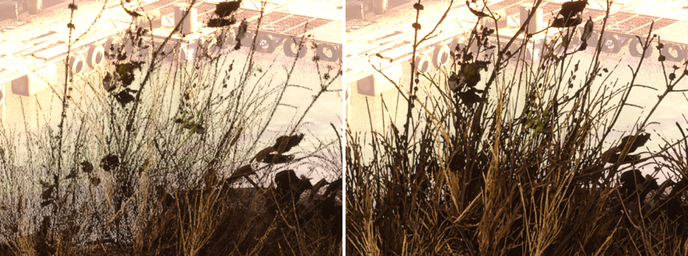
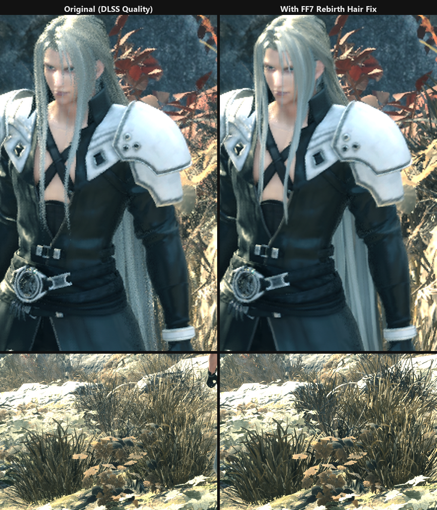

# FF7 Rebirth Vegetation Fix

A [ReShade](https://reshade.me) add-on for **FINAL FANTASY VII REBIRTH** (PC) that removes the
grainy, screen-door dithering on trees, grass and other foliage when playing with
**DLSS, DLAA or FSR**. Hair, fur and clothing have their own settings: by default they keep the
game's soft dithering, and they can be cleaned up too.

This add-on was called **FF7 Rebirth Hair Fix** before version 0.2.0. If you have that installed,
see [Upgrading from Hair Fix](#upgrading-from-hair-fix).



## Why foliage looks grainy

Rebirth draws leaves, grass, hair cards and fur as *dithered* masked materials. Instead of blending
semi-transparent pixels, every pixel is either kept or discarded by comparing its opacity against
an animated blue-noise pattern (UE's `View_SpatiotemporalBlueNoiseVolumeTexture`):

```
keep pixel if  opacity > noise.x * 255/256 + 1/512
```

The game's own TAA averages that noise over several frames into smooth translucency. DLSS and FSR
treat much of it as real detail and keep it, so thin leaves and grass blades end up dotted and
see-through, like a screen door.

## What the add-on does

As the game creates its pipelines, the add-on looks for that exact comparison in every pixel
shader (disassembling the DXIL with Microsoft's `dxcompiler.dll`) and rewrites only the two
constants that build the dithered threshold:

```
keep pixel if  opacity > threshold + (noise - 0.5) * dither_strength
```

With `dither_strength = 0`, the scenery default, it becomes a plain alpha test that DLSS/FSR can
anti-alias cleanly. Everything else stays as the game shipped it, including the separate
dither used for LOD transitions and for fading out characters close to the camera.

Because it matches the pattern rather than specific shader hashes, it covers every foliage, hair
and fur material automatically, including ones a future game patch adds. Work happens on a
background thread and patched shaders are cached on disk, so later launches skip the analysis.

Characters and scenery are patched with their own settings. A pipeline counts as a character when
its vertex shader reads Unreal's `BoneMatrices` buffer, which every skinned mesh does: hair, fur and
clothing. Everything else is scenery, including Square Enix's mesh-shader renderer that draws most
trees, rocks and buildings. A group set to threshold 0.50 and dither strength 1.00 keeps the game's
own shaders; that is the character default.

## Installation

1. Install **ReShade 6.x with add-on support** (the "with full add-on support" download from
   [reshade.me](https://reshade.me)). Point it at
   `...\FINAL FANTASY VII REBIRTH\End\Binaries\Win64\ff7rebirth_.exe` and choose **DirectX 12**.
   You don't need to pick any effect shaders.
2. Download the latest `FF7RebirthVegetationFix-v*.zip` from
   [Releases](../../releases) and extract it into the same `Win64` folder, so you end up with:
   ```
   Win64\ff7rebirth_.exe
   Win64\dxgi.dll                            (ReShade)
   Win64\FF7RebirthVegetationFix.addon64
   Win64\FF7RebirthVegetationFix.ini
   Win64\FF7RebirthVegetationFix\dxcompiler.dll
   ```
3. Start the game. Patching begins a few seconds after the title screen appears.

### Upgrading from Hair Fix

1. Extract the new zip as above.
2. Delete `FF7RebirthHairFix.addon64` and the `FF7RebirthHairFix` folder from `Win64`.
3. Start the game once. The add-on takes over your settings from `FF7RebirthHairFix.ini`;
   after that you can delete that file too.

Hair Fix 0.1.0 had one setting for everything, so it carries over to both groups and the game
looks the same as before. For the new character default, press **Game's dithering** under
Characters. If the old add-on is still installed, the overlay reminds you to delete it.

## Settings

Open the ReShade overlay (**Home**), go to the **Add-ons** tab and expand
**FF7 Rebirth Vegetation Fix**. Changes apply live and are saved to `FF7RebirthVegetationFix.ini`.
**Enabled** switches between your settings and the game's original shaders instantly, for
comparison.

The **Scenery** (trees, plants, grass and everything else) and **Characters** (hair, fur,
clothing) sections each have their own settings:

| Setting | Default | What it does |
| --- | --- | --- |
| Opacity threshold | Scenery 0.33, characters 0.50 | Pixels more opaque than this are drawn. Lower = fuller leaves and hair with chunkier edges, higher = finer but thinner and more see-through. |
| Dither strength | Scenery 0.00, characters 1.00 | 0 = clean alpha test. Values around 0.2–0.3 bring back a little softness at the edges. 1 = the game's original dithering. |
| Game's dithering | | Sets the group to threshold 0.50 and dither strength 1.00, the game's own test. Its shaders are then left alone. |

In the ini, the scenery settings are `SceneryThreshold` and `SceneryDitherStrength`, and the
character settings are `Threshold` and `DitherStrength`.

To bind a toggle hotkey, set `ToggleKey` in the ini to a
[virtual-key code](https://learn.microsoft.com/windows/win32/inputdev/virtual-key-codes)
(for example `119` for F8).

### Hair

Characters keep the game's dithering by default. With DLSS preset L it resolves into soft hair with
more depth than a cutout; with preset K it was hit and miss. If hair looks grainy in your setup,
for example with FSR or other DLSS presets, set Characters to threshold 0.33 and dither strength
0.00:



## Notes

- It applies to every material that uses this dithering. Grass and foliage follow the scenery
  settings; fur is on skinned meshes, so it follows the character settings.
- First launch: dithered pipelines are patched in the background over the first seconds of play,
  so foliage can look dithered briefly. Patched shaders are cached in
  `Win64\FF7RebirthVegetationFix\cache`. It's safe to delete that folder.
- Tested with game version 1.005 (Steam build 23447986, October 2026), ReShade 6.8.0 and DLSS
  310.3 on an RTX 5070 Ti, together with RenoDX HDR, Shader Injector 2.2.1 and the
  [NPC Motion](https://github.com/masonpetrosky/FF7RebirthNpcMotion) and
  [Anisotropic Filtering](https://github.com/masonpetrosky/FF7RebirthAnisotropic) add-ons.
- Game version 1.004 should work too, since the add-on doesn't patch the game's executable, but
  it's untested.

## Uninstall

Delete `FF7RebirthVegetationFix.addon64`, `FF7RebirthVegetationFix.ini` and the
`FF7RebirthVegetationFix` folder from `Win64`. To remove ReShade too, delete `dxgi.dll`,
`ReShade.ini` and `ReShade.log`.

## Building

Requires Visual Studio 2022 or newer with the C++ x64 tools (CMake and Ninja are included).

```powershell
.\build.ps1      # build\FF7RebirthVegetationFix.addon64 and build\dxilpatch.exe
.\package.ps1    # dist\FF7RebirthVegetationFix-v<version>.zip (downloads the pinned DXC release)
```

`dxilpatch.exe <dxc dir> <input dir> <output dir> [threshold] [dither strength]` runs the shader
patch over a folder of dumped `.cso` files. That's useful for checking the pattern still matches after a
game update. Shaders can be dumped from the add-on's **Developer** section.

## License

MIT; see [LICENSE](LICENSE). Third-party components are listed in
[THIRD_PARTY_NOTICES.md](THIRD_PARTY_NOTICES.md). FINAL FANTASY VII REBIRTH is a trademark of
Square Enix; this project is not affiliated with or endorsed by Square Enix.
