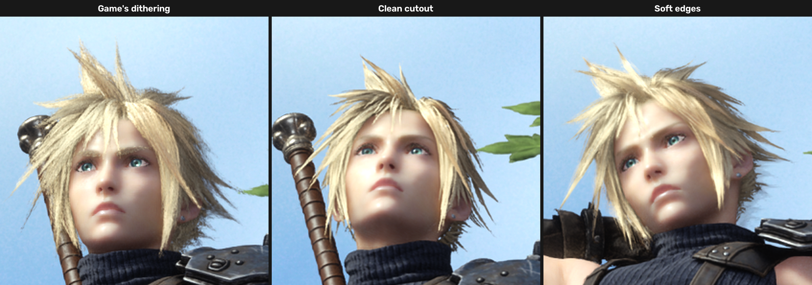

> **This mod has moved to [FF7RebirthMods](https://github.com/masonpetrosky/FF7RebirthMods/tree/main/VegetationAndHairFix)**, one repository for all
> of our FINAL FANTASY VII REBIRTH mods. This repository is archived; its releases stay here. New versions are released
> there and on Nexus Mods.

# FF7 Rebirth Vegetation and Hair Fix

A [ReShade](https://reshade.me) add-on for **FINAL FANTASY VII REBIRTH** (PC) that removes the
grainy, screen-door dithering on trees, grass and other foliage when playing with
**DLSS, DLAA or FSR**, and gives hair and fur **soft edges**: the solid part of the hair is drawn
cleanly and the thin, see-through strand tips are blended over the scene instead of being dithered
or cut away.

This add-on was called **FF7 Rebirth Vegetation Fix** before version 0.3.0 and **FF7 Rebirth Hair
Fix** before 0.2.0. If you have either installed, see [Upgrading](#upgrading).




## Why foliage and hair look grainy

Rebirth draws leaves, grass, hair cards and fur as *dithered* masked materials. Instead of blending
semi-transparent pixels, every pixel is either kept or discarded by comparing its opacity against
an animated blue-noise pattern (UE's `View_SpatiotemporalBlueNoiseVolumeTexture`):

```
keep pixel if  opacity > noise.x * 255/256 + 1/512
```

The game's own TAA averages that noise over several frames into smooth translucency. DLSS and FSR
treat much of it as real detail and keep it, so thin leaves, grass blades and hair end up dotted
and see-through, like a screen door.

## What the add-on does

As the game creates its pipelines, the add-on looks for that exact comparison in every pixel
shader (disassembling the DXIL with Microsoft's `dxcompiler.dll`) and rewrites it. Because it
matches the pattern rather than specific shader hashes, it covers every foliage, hair and fur
material automatically, including ones a future game patch adds. Work happens on a background
thread and patched shaders are cached on disk, so later launches skip the analysis. The separate
dither used for LOD transitions and for fading out characters close to the camera stays as the
game shipped it.

Characters and scenery are patched separately. A pipeline counts as a character when its vertex
shader reads Unreal's `BoneMatrices` buffer, which every skinned mesh does: hair, fur and clothing.
Everything else is scenery, including Square Enix's mesh-shader renderer that draws most trees,
rocks and buildings.

**Scenery** gets a plain alpha test, which DLSS/FSR can anti-alias cleanly:

```
keep pixel if  opacity > threshold + (noise - 0.5) * dither_strength      (dither_strength 0 by default)
```

**Characters** get soft edges. A plain alpha test alone makes hair look chunky and thin (the faint
parts are simply cut away), so the add-on adds back what it cuts:

1. The game's passes draw the solid part of the hair, the pixels more opaque than the threshold,
   as a clean alpha test. Those pixels are fully lit by the game.
2. Right before each hair draw, the add-on draws the same geometry once more with a variant of its
   pixel shader that records, per pixel, how opaque the thin parts in front of the solid surface
   are, their base colour, and which draw they belong to.
3. After the game's lighting and fog, a compute pass blends those thin parts over the image: their
   own base colour, lit like the nearest solid pixels of the same hair. Overlapping layers cover
   as much as the strongest of them, just like the game's dithering would, so hair keeps the depth
   and density the artists made it with, without the grain.

A thin layer that has no solid part of its own (such as the faint hairs painted over eyebrows) gets
no light to borrow and is left out, as with a cutout.

## Installation

1. Install **ReShade 6.x with add-on support** (the "with full add-on support" download from
   [reshade.me](https://reshade.me)). Point it at
   `...\FINAL FANTASY VII REBIRTH\End\Binaries\Win64\ff7rebirth_.exe` and choose **DirectX 12**.
   You don't need to pick any effect shaders.
2. Download the latest `FF7RebirthVegetationAndHairFix-v*.zip` from
   [Releases](../../releases) and extract it into the same `Win64` folder, so you end up with:
   ```
   Win64\ff7rebirth_.exe
   Win64\dxgi.dll                                   (ReShade)
   Win64\FF7RebirthVegetationAndHairFix.addon64
   Win64\FF7RebirthVegetationAndHairFix.ini
   Win64\FF7RebirthVegetationAndHairFix\dxcompiler.dll
   ```
3. Start the game. Patching begins a few seconds after the title screen appears.

### Upgrading

From **Vegetation Fix 0.2.0** or **Hair Fix 0.1.0**:

1. Extract the new zip as above.
2. Delete the old add-on and its folder from `Win64`: `FF7RebirthVegetationFix.addon64` and the
   `FF7RebirthVegetationFix` folder (or `FF7RebirthHairFix.addon64` and the `FF7RebirthHairFix`
   folder).
3. Start the game once. The add-on takes over your settings from the old ini
   (`FF7RebirthVegetationFix.ini` or `FF7RebirthHairFix.ini`); after that you can delete it too.

Soft edges are new and on by default; your character threshold becomes the threshold of the solid
part. If the old add-on is still installed, the overlay and ReShade.log remind you to delete it.

## Settings

Open the ReShade overlay (**Home**), go to the **Add-ons** tab and expand
**FF7 Rebirth Vegetation and Hair Fix**. Changes apply live and are saved to
`FF7RebirthVegetationAndHairFix.ini`. **Enabled** switches between your settings and the game's
original shaders instantly, for comparison.

**Scenery** (trees, plants, grass and everything else):

| Setting | Default | What it does |
| --- | --- | --- |
| Opacity threshold | 0.33 | Pixels more opaque than this are drawn. Lower = fuller leaves with chunkier edges, higher = finer but thinner and more see-through. |
| Dither strength | 0.00 | 0 = clean alpha test. Values around 0.2–0.3 bring back a little softness at the edges. 1 = the game's original dithering. |
| Game's dithering | | Sets threshold 0.50 and dither strength 1.00, the game's own test. Its shaders are then left alone. |

**Characters** (hair, fur, clothing):

| Setting | Default | What it does |
| --- | --- | --- |
| Soft edges | on | Solid part drawn cleanly, thin parts blended over the scene. Off = the scenery-style settings below. |
| Solid above | 0.50 | Parts more opaque than this are drawn solid; the rest is blended in. Lower = fuller, more solid hair. |
| Edge softness | 0.70 | How much of the thin part is blended in, as a share of the threshold (the blend fades in from threshold × (1 − softness)). Higher = wispier edges, lower = closer to a clean cutout. |
| Opacity threshold, Dither strength | 0.50, 1.00 | With soft edges off: as for scenery (0.50 / 1.00 is the game's own dithering). |

In the ini, the scenery settings are `SceneryThreshold` and `SceneryDitherStrength`; the character
settings are `SoftEdges`, `Threshold`, `SoftEdgeSoftness` and (soft edges off) `DitherStrength`.

Hotkeys are [virtual-key codes](https://learn.microsoft.com/windows/win32/inputdev/virtual-key-codes)
in the ini, 0 = none:

- `ToggleKey` switches the whole fix on and off (for example `119` for F8).
- `SoftEdgesKey` switches soft edges on and off, so you can compare them with a clean cutout (for
  example `117` for F6). With Shift held it cycles the debug views (see Developer).

## Notes

- It applies to every material that uses this dithering. Grass and foliage follow the scenery
  settings; fur is on skinned meshes, so it follows the character settings.
- Soft edges cost very little: one extra draw per hair, fur or eyelash mesh and a few compute passes
  at render resolution after the fog pass. They need the game's fog pass, which every area tested
  so far has; ReShade.log warns if hair is drawn for a while without one (the hair then shows the
  clean cutout).
- First launch: dithered pipelines are patched in the background over the first seconds of play,
  so foliage and hair can look dithered briefly. Patched shaders are cached in
  `Win64\FF7RebirthVegetationAndHairFix\cache`. It's safe to delete that folder.
- Tested with game version 1.005 (Steam build 23447986, October 2026), ReShade 6.8.0 and DLSS
  310.3 (preset L) on an RTX 5070 Ti, together with RenoDX HDR, Shader Injector 2.2.1 and the
  [NPC Motion](https://github.com/masonpetrosky/FF7RebirthNpcMotion) and
  [Anisotropic Filtering](https://github.com/masonpetrosky/FF7RebirthAnisotropic) add-ons.
- Game version 1.004 should work too, since the add-on doesn't patch the game's executable, but
  it's untested.

## Uninstall

Delete `FF7RebirthVegetationAndHairFix.addon64`, `FF7RebirthVegetationAndHairFix.ini` and the
`FF7RebirthVegetationAndHairFix` folder from `Win64`. To remove ReShade too, delete `dxgi.dll`,
`ReShade.ini` and `ReShade.log`.

## Building

Requires Visual Studio 2022 or newer with the C++ x64 tools (CMake and Ninja are included) and the
Windows SDK (its `dxc` compiles the add-on's compute shaders).

```powershell
.\build.ps1      # build\FF7RebirthVegetationAndHairFix.addon64, build\dxilpatch.exe, build\softedges_test.exe
.\package.ps1    # dist\FF7RebirthVegetationAndHairFix-v<version>.zip (downloads the pinned DXC release)
```

Developer tools:

- `dxilpatch.exe <dxc dir> <input dir> <output dir> [threshold] [dither strength]` runs the shader
  patch over a folder of dumped `.cso` files, and `dxilpatch.exe --fringe <dxc dir> <input dir>
  <output dir> [threshold] [fade from]` makes the soft-edge variants. That's useful for checking
  the patterns still match after a game update. Shaders can be dumped from the add-on's
  **Developer** section.
- `softedges_test.exe` runs the soft-edge compute passes on a synthetic frame with the Direct3D 12
  debug layer and GPU-based validation.
- The **Developer** section has the soft-edge debug views: the blended parts' opacity and colour,
  and the solid parts.

## License

MIT; see [LICENSE](LICENSE). Third-party components are listed in
[THIRD_PARTY_NOTICES.md](THIRD_PARTY_NOTICES.md). FINAL FANTASY VII REBIRTH is a trademark of
Square Enix; this project is not affiliated with or endorsed by Square Enix.
